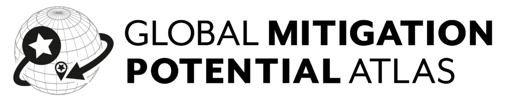

# STEVFNs Tool - GMPA

🚧 Documentation is under construction, see [Development stage](#development-stage) 🚧

The STEVFNs Tool is a Python implementation of the Space-Time Energy Vector Flow Networks (STEVFNs) modeling framework. This particular implementation of it is the underlying model and assumptions for the [Global Mitigation Potential Atlas (GMPA)](https://mitigationatlas.org).

The tool can be installed independently and used in local repositories with custom data. This documentation will serve to enable users to set up the tool on their own, as well as a complementary documentation framework for the assumptions and model design behind the GMPA.

## Development stage

The migration to the new workflow, refactored model and updated time-dependent implementation is ongoing. This documentation is being developed alongside it and thus does not yet contain all the required information, and will therefore be continuously updated.
The expected timeline for completion of this phase is February 2027.
