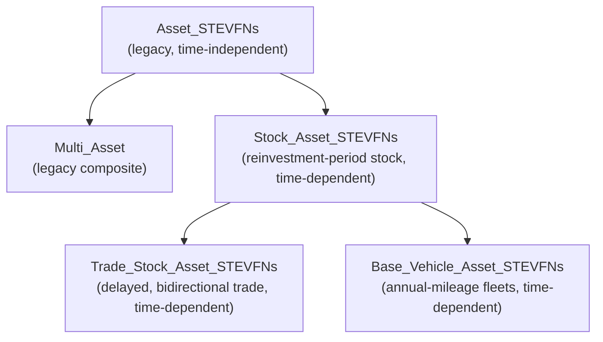
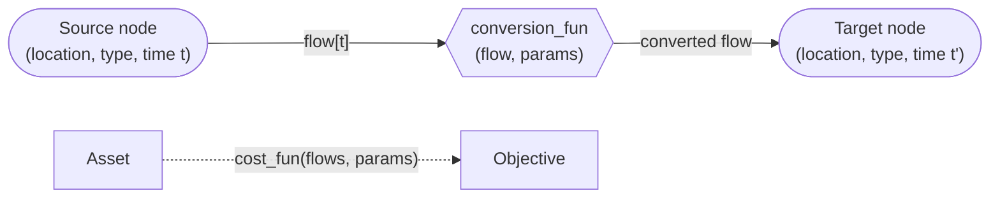
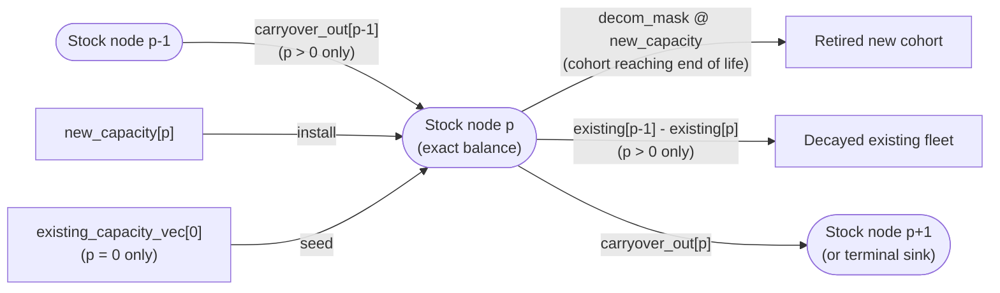
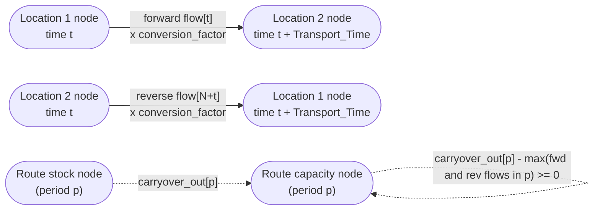
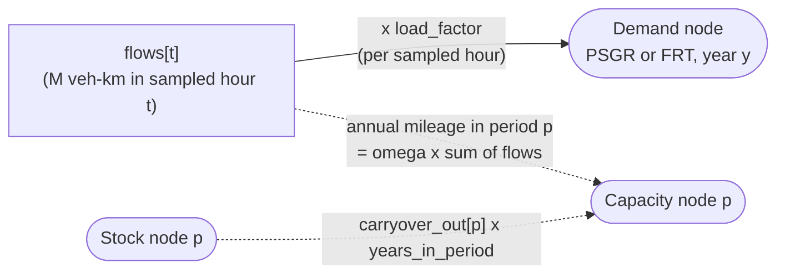

# Base Assets
---

The base asset classes hold the modelling assumptions that every specific technology asset
inherits: how investment decisions are timed, how capacity is accounted for over the
model horizon, and how costs enter the model objective function. Technology pages (see
[STEVFNs Assets](assets.md)) describe their own parameters and equations in more
detail, but anything that comes from a base class is defined here.

!!! info "How to read this page"
    This page describes what the code currently does. Behaviour is often a
    simplification, an assumed convention, or an open limitation, these are 
    flagged in a note and collected in [Implementation notes](#implementation-notes).

## Overview

| Base class | Module | Time treatment | Intended for |
|---|---|---|---|
| `Asset_STEVFNs` (and `Multi_Asset`) | `assets/Base_Assets.py` | Legacy: capacity sized once, replaced every lifespan, flows treated as one stationary year | High-level understanding of benefits of trade over greenfield, overnight installs model. Some behaviour and result export is maintained for this base |
| `Stock_Asset_STEVFNs` | `assets/Base_Stock_Assets.py` | Time-dependent: capacity cohorts installed every reinvestment period, retired by lifetime | Time-dependent, high-level models, understanding where but also _when_ investment is cost-optimal in different systems. Used as base for power and industry sector assets |
| `Trade_Stock_Asset_STEVFNs` | `assets/Base_Trade_Assets.py` | As stock, plus construction delay and distance-dependent costs and losses | Electricity trade (HVDC), H2 and NH3 shipping assets with time-dependent implementation |
| `Base_Vehicle_Asset_STEVFNs` | `assets/Base_Vehicle_Assets.py` | As stock, capacity expressed as annual mileage | Transport sector models: Passenger and freight vehicle fleets (ICE, EV) |

## Shared conventions

These conventions apply to the three time-dependent base classes
(`Stock_Asset_STEVFNs` and its two base children). The legacy base class is described
separately in [Legacy base asset](#legacy-base-asset).

### Notation

| Symbol | Code | Meaning | Value in default setup |
|---|---|---|---|
| $Y$ | `num_years` | Project life in whole years, `int(project_life / 8760)` | 25 (`project_life` = 219 000 h) |
| $R$ | `reinvestment_period` | Reinvestment period in whole years | 5 (`reinvestment_period` = 43 800 h) |
| $P$ | `num_periods` | Number of reinvestment periods, $\lceil Y/R \rceil$ | 5 |
| $D$ | derived | Sampled (representative) days per year | 1 in the reference network |
| $N$ | `number_of_edges` | Sampled hourly timesteps, $24\,D\,Y$ | 600 |
| $\omega$ | annualisation factor | $365/D$, scales sampled days to a full year | 365 |
| $r$ | `discount_rate` (system) | Discount rate used for NPV | 0.05 |
| $i$ | `interest_rate` (asset) | Financing rate used in the capital annuity | per asset |
| $L_y$ | `lifespan / 8760` | Asset lifetime in years | per asset |
| $L$ | `_lifetime_periods` | Lifetime in whole reinvestment periods | per asset |
| $s_p, e_p$ | `period_start_years`, derived | Start and end model year of period $p$ | see table below |
| $x_k$ | `new_capacity[k]` | Capacity installed at the start of period $k$ | decision variable |
| $\bar{x}_p$ | `carryover_out[p]` | Operating capacity stock in period $p$ | decision variable |
| $c_k$ | sizing constant vector | Capital cost per unit capacity for cohort $k$ | per asset |
| $\delta$ | `existing_capacity_decay_rate` | Decay of the pre-model fleet per reinvestment period | per asset |

!!! info "System Defaults"
    `project_life` and `reinvestment_period` are set in each scenario's
    `System_Parameters.csv`. The 25-year project life with 5-year reinvestment
    periods is the assumed default for this phase. Values are in hours, and all base
    classes convert with a hard-coded 8760 h/year, so a 1-hour timestep is assumed
    (the `timestep` system parameter is not used by the base classes).

### Time structure

Three timescales coexist in every time-dependent asset:

- **Reinvestment period** (5 years): the only moments at which capacity can be added.
- **Year**: the resolution of annual balances (e.g. industry annual demand nodes) and of discounting costs.
- **Sampled hour**: the resolution of dispatch. Each model year is represented by $D$
  sampled days of 24 hours, spread evenly across each year and throughout project life concatenated along a single time axis.

Each install decision (install _i_) happens at the first year of each reinvestment period; the last period includes
terminal charges for capacity installed late whose annuities extends past project_life.

With the default setup, one sampled day per year, and results labelled from 2025:

|   Period $p$ |  Model years |  Results year label |  `years_in_period` | Sampled hourly indices   ($D=1$)   in sampled profile |
|---|---|---|---|---|
| 0 | 0 to 4 | 2026 | 5 | 0 to 119 |
| 1 | 5 to 9 | 2031 | 5 | 120 to 239 |
| 2 | 10 to 14 | 2036 | 5 | 240 to 359 |
| 3 | 15 to 19 | 2041 | 5 | 360 to 479 |
| 4 | 20 to 24 | 2046 | 5 | 480 to 599 |

The results year label is `start_year + p × reinvestment_period` (the `start_year` is
passed to the results compiler in `main.py`).

**Decision rules common to all time-dependent assets**

- All new capacities $x_k$ are chosen simultaneously in one optimisation (perfect foresight over the whole horizon).
- Capacity is continuous: there are no integer unit sizes or minimum build sizes.
- A cohort installed in period $k$ is available from the start of period $k$
  (model year $kR$). Trade assets add a construction delay (see [Trade assets](#trade-assets)).
- Retirement is not a decision. New cohorts retire after a fixed lifetime, and the
  pre-model (existing) fleet decays exogenously. Capacity can sit idle, but cannot be
  retired early. Retirement does not have an associated cost in the cost function.
- Dispatch in each sampled hour is limited by the operating stock of the period it falls in.

!!! warning "Periods that do not divide the project life"
    If $Y$ is not a multiple of $R$, the final period is shorter (e.g. $Y=27$,
    $R=5$ gives a final period of 2 years). `_years_in_period` accounts for this when
    averaging reported values. Project life is truncated to whole years by
    `int(project_life / 8760)`.

### Sampled hours and annualisation

The sampled axis contains number of edges $N = 24\ ·D\ ·Y$ hourly nodes. Each sampled day stands for
$365/D$ real days, so quantities that accrue per sampled hour are multiplied by
an annualisation factor $\omega = 365/D$ whenever they enter an annual or lifetime quantity (this applies to e.g. usage cost,
emissions, annual mileage).

$D$ directly is not an input: it is recovered in the code as
`int((number_of_edges / 24) / num_years)`. The `int()` floors the result, so a
network with fewer than 24 sampled hours per year gives $D=0$, which breaks the
annualisation factor $365/D$ (division by zero) or collapses year and period boundaries.

The user input to determine `number_of_edges` is the subtraction of `End_Time` - `Start_Time` values
inside the `Network_Structure.csv` of a Case Study folder. The convention here is to set `Start_Time`to 0
and `End_Time` to 600 as the minimum sample size for a 25 year project.

!!! warning "Sampling Method Caveats"
    With $D=1$ (600 hours over 25 years), each year is represented by a single
    day. The profile loaders pick representative days evenly through the year, so for
    $D=1$ the PV loader uses a mid-year day (around early July). Consequences
    that apply to every time-dependent asset:

    - Seasonality is not represented, so capacity limits are sized against that one day per year.
    - Peak-based capacity constraints (`cp.max` over a period) see only 5 sampled days per period.
    - The hourly time axis is a concatenation of days across years
    - Increasing the granularity is computationally expensive, as each increase has to be by 600 hours. Depending on the number of assets in a netowrk structure, this may increase build and solve times considerably
    - If `project_life` is changed from the 25 years default, the definition of sampling size in `Network_Structure.csv` (`End_Time` - `Start_Time`) must be a multiple of $24\ · Y$. This minimum `set_size` of 24 hours is currently hard-coded in different places in the code; a later revision should refactor this

### Cost principles

The detailed formulation is in [Stock assets](#stock-assets). The principles that all
time-dependent assets share are:

1. All costs are **net present values at model year 0** in constant prices. No
   inflation or escalation is applied in the base classes, so price trajectories
   must be provided through the sizing-constant profiles.
2. A payment made in model year $y$ is discounted by $(1+r)^{-y}$. Year 0 is
   undiscounted.
3. Capital cost applies to **new** capacity only. The existing fleet is treated as sunk.
4. Capital is financed as an annuity over the asset lifetime at the asset's
   `interest_rate`, starting in the year of installation. The annuity is discounted
   at the system `discount_rate`, so $i \neq r$ is allowed and changes the NPV of
   financing.
5. The objective charges the **whole** repayment stream of every cohort: the part
   inside the horizon plus a **terminal charge** for repayments falling after the
   project life. This prevents late investments from looking artificially cheap
   because the horizon cuts off their payments.
6. **Reported** costs (results CSVs generated after the optimisation) include only
   repayments inside the horizon and exclude the terminal charge, truncating at project life.
7. Energy costs are not attached to the consumers of energy. Electricity, for
   example, is priced implicitly for the system by the electricity generation assets and the
   network that supplies it.

## Legacy base asset

**Asset class(es)**: `Asset_STEVFNs`, `Multi_Asset` 
**Module**: `assets/Base_Assets.py` 
**Base class**: none 

`Asset_STEVFNs` is the original STEVFNs asset abstraction. It has no reinvestment
periods: capacity is sized once, from the peak of the hourly flows, and replaced on a
fixed cycle. It remains the base for demand assets, the CO2 budget, and any
technology that has not been migrated to the stock formulation. It also defines the
parts of the interface that all assets share (building edges, loading parameters,
results getters).

### Structure

An asset owns a vector `flows` (a `cvxpy` Variable, Parameter or Constant) with one
entry per sampled hourly timestep and builds one `Edge_STEVFNs` per entry:

- `source_node_*`: the node the flow leaves. Attached edges act as **withdrawals** from that node.
- `target_node_*`: the node the flow enters. The flow that arrives **after** a `conversion_fun`
  (for example an efficiency, a loss or an emissions factor).
- A node with `NULL` as its type has no node on that side. A target-less edge has no
  conversion applied.
- Each node balances `output_flows - input_flows` against zero. By default
  (`curtailment = True`) the balance at the node is an inequality (`<= 0`, supply may exceed
  demand); stock nodes set `curtailment = False` and balance exactly.

### Parameter loading

The method `update(asset_type)` reads row `asset_type` of
`src/assets/<asset_name>/parameters.csv`. Values are assigned to the entries of
`cost_fun_params` and `conversion_fun_params` by column name, then each asset (a child class
of Asset_STEVFNs) applies its own NPV scaling in `_update_parameters`.
`asset_type` comes from the scenario's `data/Case_Study/<case_study_name>/<scenario_name>/Asset_Parameters.csv`
(`Asset_Number`, `Asset_Type`), so one network structure can be re-run with different technology options per scenario.

`Multi_Asset` bundles several assets (for example, the original time-independent BESS = charging, discharging and
storage components). It builds each child, combines their costs with its own `cost_fun`, and
passes either an `asset_type` row index or its own `parameters_df` to each child
(`_update_assets`).

### Legacy cost conventions

For a legacy asset with a lifespan of $L_y$ years in a project of $Y$ years:

**Sizing (capital) cost.** The capital constant is scaled by an NPV factor that
assumes the asset is bought in full at the start and again every lifespan:

$$
N = \left\lceil \frac{\text{project\_life}}{\text{lifespan}} \right\rceil,\qquad
\rho = (1+r)^{-L_y},\qquad
F_{\text{size}} = \sum_{j=0}^{N-1} \rho^{\,j} = \frac{1-\rho^{N}}{1-\rho}
$$

There is no salvage value: if the lifespan exceeds the project life, the full
capital cost is still charged once.

**Usage cost.** The usage constant is scaled by

$$
\omega_L = \frac{8760}{N_{\text{sim}}},\qquad
F_{\text{use}} = \sum_{y=0}^{Y-1} (1+r)^{-y}
$$

where $N_{\text{sim}}$ is `system_structure_properties["simulated_timesteps"]`, the
span of node times in the network (600 in the reference network). This treats the whole
sampled set as **one typical year**, repeated every year of the project.

!!! note "Legacy and time-dependent annualisation agree for stationary flows"
    For $N_{\text{sim}} = 24\,D\,Y$, $\omega_L \cdot (24\,D\,Y) = 8760$, which is
    the same total annualisation as $\omega = 365/D$ applied to each year of
    the stock formulation. The two conventions differ only in that the stock
    formulation discounts each sampled year separately and lets flows differ by year.

**Peak-based sizing.** Typical legacy cost functions combine a sizing term on
`cp.max(flows)` with a usage term on `cp.sum(flows)`.

## Stock assets

**Asset class**: `Stock_Asset_STEVFNs` 
**Module**: `assets/Base_Stock_Assets.py` 
**Base class**: `Asset_STEVFNs` 

The stock base class gives an asset a period-indexed capacity stock and a single shared
cost function. It does not build any hourly edges itself. Subclasses (each individual asset, e.g. PV, wind,
fossil generators and others) build their own dispatch or generation edges on top.

### Decision variables

| Variable | Shape | Meaning |
|---|---|---|
| `new_capacity` ($x_k$) | $P$ | Capacity installed at the start of period $k$, $\ge 0$ |
| `carryover_out` ($\bar{x}_p$) | $P$ | Operating capacity in period $p$, $\ge 0$ |
| `flows` | $N$ or `Constant(0)` | Hourly dispatch variable. Defaults to a constant 0 (e.g. PV and wind, whose output is derived from `carryover_out` and a profile). Dispatchable assets (e.g. PP_CO2) replace it with a Variable |

### Stock accounting

Each period has a **stock node** (`stock_node_type`, `node_time = p`) that balances
with equality. Its edges are:

The balance for period $p$ is

$$
\bar{x}_p \;=\; \bar{x}_{p-1} + x_p - \sum_k D_{p,k}\,x_k - \big(e_{p-1} - e_{p}\big)
$$

with $\bar{x}_{-1} = 0$, the pre-model fleet seeded once as $e_0$ in period 0, and
$e_p$ = `existing_capacity_vec[p]`. Unrolling the recursion gives the closed form:

$$
\bar{x}_p \;=\; e_p \;+\; \sum_{k \le p} x_k \;-\; \sum_{k \le p-L} x_k
$$

so the operating stock is the decayed existing fleet plus every new cohort installed
within the last $L$ periods, including the current one.

**Decommissioning of new cohorts.** The mask is $D_{p,k}=1$ if $k = p - L$, with

$$
L = \max\big(\text{round}(L_y / R),\, 1\big)
$$

A cohort installed in period $k$ therefore operates in periods $k, \dots, k+L-1$ and
leaves the stock at the start of period $k+L$. If $k+L \ge P$, it never retires
within the horizon.

**Existing (pre-model) fleet.** The pre-model fleet carries no capital cost. Its
level in period $p$ is `existing_capacity × retention[p]`, where the retention comes from
`decommission_mode`:

| `decommission_mode` | Retention $[p]$ | Inputs |
|---|---|---|
| `decay_rate` (default) | $(1-\delta)^p$ | `existing_capacity_decay_rate` (fraction per reinvestment period) |
| `profile` | Read from CSV | `existing_capacity_profile_filename`: `location_name`, `period_index`, `retention_fraction`, with exactly $P$ rows per location  This decomission mode is implemented in the code but has not been formally tested |

The decay rate is **per reinvestment period**, so changing $R$ requires changing
$\delta$ to keep the same annual decay. In `profile` mode the retention must be
non-increasing; an increase would make `existing[p-1] - existing[p]` negative, which
the stock node treats as an injection.
The decay rate implementation aims to allow the simulation of slowly decomissioning capacity
in the model, but as other assumptions in this implementation is an abstraction. These values
are therefore assumptions from the model designer and should be treated as such.

**Dispatch cap pattern (used by child asset classes).** Dispatchable stock assets limit hourly
dispatch within each period by the operating stock through a capacity node
(`node_time = p`) with a target-only edge:

$$
\bar{x}_p - \max_{t \in p} f_t \;\ge\; 0
$$

The capacity node keeps the default `curtailment = True`, which turns the edge flow
into this inequality.

### Capital cost

Capital cost per unit capacity for cohort $k$, $c_k$, is supplied by the child class as a
vector of length $P$ (a scalar broadcast for constant costs, or a profile that
carries a learning curve, depending on user input). The base class then does the following.

**1. Annuity.** Capital is repaid in equal annual payments over $L_y$ years at
the asset's interest rate $i$:

$$
a_k \;=\; c_k \cdot \frac{i\,(1+i)^{L_y}}{(1+i)^{L_y}-1}
$$

**2. Payment window.** Cohort $k$ is installed in model year $s_k = kR$ and pays in
every year from $s_k$ up to the payoff year $s_k + L_y$. Payments are allocated to
reporting periods by overlap with each period's years $[s_p, e_p)$ and discounted
at $r$:

$$
M_{p,k} \;=\; a_k \sum_{y=\max(s_p,\,s_k)}^{\min(e_p,\,s_k+L_y)-1} (1+r)^{-y}
$$

Year boundaries are rounded to whole years. $M$ is stored in the Parameter
`sizing_constant` (shape $P \times P$, lower-triangular in practice).

**3. Terminal charge.** If the payoff year falls after the horizon, the remaining
payments are discounted to year 0 and charged against the cohort:

$$
\tau_k \;=\; a_k \sum_{y=Y}^{s_k+L_y-1} (1+r)^{-y}\quad \text{if } s_k+L_y > Y,\; \text{else } 0
$$

**4. Cost function.** All stock assets share a single `cost_fun`:

$$
C \;=\; \underbrace{\sum_{p}\sum_{k} M_{p,k}\,x_k}_{\text{capital inside horizon}}
\;+\; \underbrace{\sum_t u_t\, f_t}_{\text{usage}}
\;+\; \underbrace{\sum_k \tau_k\, x_k}_{\text{terminal charge}}
$$

Usage and flows default to a constant 0, so the function collapses to capital cost
for assets with no dispatch cost. No subclass currently overrides it.

!!! tip "Input Types for Capital Cost Parameters"
    If learning curve profiles projected to the future are desired, all assets within the `Network_Structure.csv`
    to be modelled must have a profile. In `src/assets/<asset_name>/parameters.csv` column for `sizing_constant`
    the user must input either a scalar for all asset types or a profile filename (without the .csv extension) and
    include the relevant profile in `src/assets/<asset_name>/profiles/` folder.

#### Worked example: asset lifespan of 15 years

With project life $Y = 25$, reinvestment period $R = 5$ and asset lifespan $L_y = 15$ (asset lifetime in whole reinvestment periods $L = 3$):

| Cohort $k$ | Installed (year) | Operating periods | Leaves stock at | Repayment years | In-horizon periods ($M_{p,k}>0$) | Terminal-charge years |
|---|---|---|---|---|---|---|
| 0 | 0 | 0 to 2 | period 3 | 0 to 14 | 0, 1, 2 | none |
| 1 | 5 | 1 to 3 | period 4 | 5 to 19 | 1, 2, 3 | none |
| 2 | 10 | 2 to 4 | beyond horizon | 10 to 24 | 2, 3, 4 | none |
| 3 | 15 | 3 to 4 | beyond horizon | 15 to 29 | 3, 4 | 25 to 29 |
| 4 | 20 | 4 | beyond horizon | 20 to 34 | 4 | 25 to 34 |

!!! info "Financing rate versus discount rate"
    The `interest_rate` of an asset sets the size of the annual payments; `discount_rate`
    (system) sets their present value. If $i > r$, the NPV of financing exceeds the
    overnight capex (about 1.39 times in the example above). If $i = r$, it
    equals it (apart from the start-of-year discounting convention, below).

!!! warning "Conventions to be aware of"
    - `interest_rate = 0` is undefined in the annuity formula (0/0). Use a small positive
      value if assuming no loan repayments for capital.
    - Financing life and operating life can differ. Payments run for exactly
      $L_y$ years, but retirement happens after $\text{round}(L_y/R)$ whole periods.
      For example, with $R=5$, $L_y=12$ pays for 12 years but operates for
      10 years ($L=2$), and $L_y=13$ pays for 13 years but operates for 15 ($L=3$).
      **The two agree only when the lifespan is a multiple of $R$, which is a general convention
      for input parameters.**

### Usage cost

For assets with an hourly dispatch variable, the usage constant is expanded to a vector
over sampled hours. For a timestep $t$ falling in model year $y(t)$:

$$
u_t \;=\; u_0\,(1+r)^{-y(t)}\,\omega
$$

Each sampled hour is therefore discounted at its own year and scaled by
$\omega = 365/D$. Assets with no usage cost keep the default `Constant(0)`.

### Subclass contract

A stock subclass must:

1. In `define_structure`, call `_define_period_structure(asset_structure)` (creates
   $x$, $\bar{x}$, the cost Parameters, the decommission mask and the existing-fleet
   vector). Dispatchable subclasses then replace `flows` and
   `cost_fun_params["usage_constant"]`.
2. In `build_edges`, call `_build_stock_edges()` (plus its own generation, dispatch,
   capacity-limit or demand edges).
3. In `_update_parameters`, build the sizing vector $c$, then call, in this order:
   `_update_sizing_constant(c)`, `_update_new_capacity_decom_mask()` and
   `_update_existing_capacity_vec()`. `_update_sizing_constant` calls
   `_get_lifetime_periods()` itself.

### Parameters read by the base class

| Parameter | Units | Description |
|---|---|---|
| `lifespan` | hours | Asset lifetime (years × 8760). Drives the decommission mask ($L$) and the repayment window ($L_y$) |
| `interest_rate` | fraction per year | Financing rate in the annuity. Must be 0>$i$>1 |
| `sizing_constant` | Billion USD per unit capacity | Capital cost per unit of new capacity. Read by the subclass (scalar, or profile filename for time-varying costs) and passed to `_update_sizing_constant` as a vector of length $P$ |
| `usage_constant` | Billion USD per unit flow | Only for dispatchable assets. Subclass expands it to hourly values |
| `existing_capacity` | capacity unit | Pre-model operating capacity at the start of period 0 |
| `existing_capacity_decay_rate` | fraction per reinvestment period | Used when `decommission_mode = "decay_rate"` |
| `existing_capacity_profile_filename` | string | Used when `decommission_mode = "profile"`. CSV in `profiles/` |
| `location_name` | string | Filter for profile files |

System parameters used: `project_life` (hours), `reinvestment_period` (hours), `discount_rate` (fraction per year).

### Reporting

| Getter | Returns |
|---|---|
| `size()` / `asset_size()` | `new_capacity` array (one value per period) |
| `get_new_capacity()` | Same as above, as an array, or `None` before solving |
| `get_operating_stock()` | `carryover_out` array |
| `get_period_costs()` | See below |

The reported period cost is the in-horizon capital repayments due in period $p$ plus
any usage cost incurred in it, expressed as an **average annual NPV**:

$$
\text{cost}_p \;=\; \frac{1}{Y_p}\left(\sum_k M_{p,k}\,x_k \;+\; \sum_{t\in p} u_t f_t\right),\qquad Y_p = \text{years\_in\_period}(p)
$$

Reported values are discounted to model year 0, so they are **not** nominal annual
spend. Summing $Y_p \cdot \text{cost}_p$ over periods gives the total in-horizon NPV
(without terminal charge), which is why reported costs differ from the problem objective 
value by $\sum_k \tau_k x_k$.

`get_period_capacity()` is not defined in the stock base class (it returns `None`).
Subclasses that want capacity reported must override it; the trade and vehicle bases
do, returning the operating stock. The default `capacity_unit` is `GWp`.

## Trade assets

**Asset class**: `Trade_Stock_Asset_STEVFNs` 
**Module**: `assets/Base_Trade_Assets.py` 
**Base class**: `Stock_Asset_STEVFNs` 

Base class for energy carrier transport links between two locations (electricity cables, or H2,
NH3 shipping). It reuses the stock formulation and adds (i) bidirectional hourly
flows that share one capacity, (ii) distance-dependent cost and loss, and (iii) a
construction delay between investment and operation.

### Structure

- `flows` has length $2N$: entries $[0, N)$ are forward, $[N, 2N)$ reverse.
- Capacity is shared: the cap in each period is on the maximum over both
  directions combined (`cp.max` of the horizontally stacked forward and reverse flows).
  A bidirectional link is sized for its larger direction, not the sum.
- Stock and capacity nodes have route-unique types,
  `<asset_name>_Stock_from_<A>_to_<B>` and `<asset_name>_Capacity_from_<A>_to_<B>`,
  so two routes with a common endpoint do not pool capacity. Both sit at the
  **source** location.
- `Transport_Time` shifts the target node time, modulo `End_Time` (see the
  sampling warning below).

### Distance-dependent parameters

Distance $d$ is the great-circle (haversine) distance between the two locations in
megametres (Earth radius 6.371 Mm), computed from `lat_lon_df`. All three
trade parameter groups are linear in $d$:

| Quantity | Formula |
|---|---|
| Sizing (capital) constant | $c = c_1 + c_2\,d$ |
| Usage constant | $u_0 = u_1 + u_2\,d$ |
| Conversion factor | $\eta = 1 - (\ell_1 + \ell_2\,d)$ |

The conversion factor is applied to the flow at the target node, so
$\ell_1 + \ell_2 d$ is the fraction lost in transit. A value above 1 would give a
negative (invalid) Parameter.

The capital constant is a **scalar** broadcast across periods (no learning curve), then
passes through the standard annuity, window and terminal-charge pipeline of the
[stock assets](#stock-assets).

!!! note "Location indexing"
    The distance lookup uses `lat_lon_df.iloc[int(location)]`, i.e. **position**
    in the table, not label. Location indices in `Network_Structure.csv` must match
    the row order of `Location_Parameters.csv` (0, 1, 2, ...).

!!! warning "Pending dev documentation"
    Update the docs for trade assets on shipping updates for average shipping days

## Vehicle assets

**Asset class**: `Base_Vehicle_Asset_STEVFNs` 
**Module**: `assets/Base_Vehicle_Assets.py` 
**Base class**: `Stock_Asset_STEVFNs` 

Base class for vehicle fleets (ICE and EV, passenger and freight). The decision is the
size of the fleet in **annual mileage** terms; hourly flows are mileage in each sampled
hour.

### Structure

- **Variables:** `flows` (hourly, M veh-km per sampled hour, $\ge 0$) and the stock
  variables $x_k$ and $\bar{x}_p$ in M veh-km per year.
- **Demand edges:** each hourly flow feeds the demand node of its **year** (`node_time =
  year`), multiplied by `load_factor` to convert to passenger-km or tonne-km. The
  node keeps the default curtailment, so supply may exceed demand.
- **Capacity limit:** the total mileage in a period, annualised, may not exceed
  operating capacity times the years in the period:

$$
\bar{x}_p \cdot Y_p \;\ge\; \omega \sum_{t\in p} f_t
$$

!!! note "Average mileage constraint"
    The constraint binds the **total** over the period, so the fleet may be driven
    harder in one year if it is driven less in another year of the same period.
    Demand, however, is balanced year by year.

!!! note "Demand scaling"
    The demand-side edges carry the sampled flows without annualisation (only the
    capacity-limit edge is multiplied by $\omega$). The corresponding transport
    demand asset must therefore be expressed on the same sampled-hour basis;
    otherwise annual mileage in the capacity limit is overstated by a factor of up
    to 365. This is not enforced in the base class.

### Costs

- **Capital only.** The sizing constant is a scalar "TCO-equivalent" capital value per
  M veh-km of annual capacity, broadcast across periods, then passed through the
  standard annuity pipeline of the stock assets (including the terminal charge).
- **No usage cost.** `usage_constant` stays the default `Constant(0)`.
- **No fuel or emissions in the base class.** Electricity for EVs is paid for
  implicitly through the EL node network supplying the vehicles. ICE fuel is not
  modelled, and no vehicle emissions are produced by this class.

!!! warning "Data limitation"
    Because the model has no usage costs and no ICE fuel costs, differences between
    technologies come only from the capital value and load factor. The sizing
    constant should therefore be read as an incomplete TCO until fuel and operating
    costs are added in a later development phase.

### Parameters read by the vehicle base class

<!-- TODO: confirm units against the parameters.csv files before publishing. -->

| Parameter | Units | Description |
|---|---|---|
| `lifespan` | hours | Vehicle lifetime (same convention as stock assets) |
| `interest_rate` | fraction per year | Financing rate in the capital annuity |
| `sizing_constant` | Billion USD per M veh-km per year | TCO-equivalent capital value |
| `load_factor` | passengers or tonnes per vehicle | Converts M veh-km to M passenger-km or M tonne-km |
| `existing_capacity` | M veh-km per year | Pre-model fleet capacity at period 0 |
| `existing_capacity_decay_rate` | fraction per reinvestment period | Decay of the pre-model fleet |

`Period` is fixed to 1 hour in the class (`self.period`) and `transport_time` is unused.

### Reporting

| Getter | Returns |
|---|---|
| `get_period_costs()` | Capital repayments only (average annual NPV per period) |
| `get_period_capacity()` | Operating fleet (`carryover_out`) |
| `get_period_flows()` | Hourly flows split by period |

`capacity_unit` is `"M veh-km"`, which stands for annual mileage capacity (M veh-km per year).

## Results interface

All assets expose the same getters to `compile_results.py`. Each returns an array of
length $P$ (or `None` if the asset does not produce the metric, in which case it is
omitted from the output):

| Getter | Metric | Unit in output |
|---|---|---|
| `get_period_costs()` | `cost` | Billion USD (average annual NPV in the period, see [Stock assets](#reporting)) |
| `get_period_emissions()` | `emissions` | MtCO2e |
| `get_period_capacity()` | `capacity` | `capacity_unit` of the asset |

`get_results_records()` converts these to long-format rows
(`country, year, technology, metric, unit, value`) with
`year = start_year + p × reinvestment_period`. The technology name comes from
`readable_names.csv` (falling back to `asset_name`), and the country is resolved from the
source location, then the target location. The legacy base class returns `None` for
all three getters, so a legacy asset only appears in the results if it overrides
them.

## Implementation notes

Behaviour that follows from the current code and may need review as the model develops.
!!! warning "Pending review"
    Edits to shipping assets requires this table to be reviewed

| # | Area | Behaviour | Effect |
|---|---|---|---|
| 1 | Stock, Trade, Vehicle | Repayment window uses exact $L_y$; retirement uses `round(L_y/R)` periods | Financing life and operating life differ unless lifespan is a multiple of $R$ |
| 2 | Stock | Annuity assumes end-of-year payments; discounting uses start-of-year index | NPV slightly above an end-of-year convention |
| 3 | Stock | `interest_rate = 0` gives 0/0 in the annuity factor | Parameter must be strictly positive |
| 4 | Stock | `profile` retention must be non-increasing | An increase acts as an injection of capacity |
| 5 | Stock | Decay rate is per reinvestment period | Changing $R$ requires changing the decay rate |
| 6 | Stock | `get_period_capacity()` not defined in the base class | Subclasses (e.g. PV, PP_CO2) report no capacity unless they override it |
| 7 | Stock, Trade, Vehicle | Reported cost is average annual NPV at year 0, excluding terminal charge | Not nominal annual spend; differs from the objective by the terminal charge |
| 8 | Trade | Delay rounds up to whole periods | Sub-period delays become a full period |
| 9 | Trade | Investments with $k+d \ge P$ are paid for but never operate | Never chosen by the optimiser; last-period investment is useless when $d \ge 1$ |
| 10 | Trade | Financing starts at investment, operation after the delay | Construction-period financing cost with no capacity |
| 11 | Trade | Periods are cut into $P$ equal chunks of sampled edges | Only aligned to real periods when $Y$ is a multiple of $R$ |
| 12 | Trade | `Period > 1` and `Transport_Time` in sampled-hour units with $D=1$ | Year indices collapse, usage discounting is wrong, arrivals land in other sampled years |
| 13 | Trade | Usage cost scaled by $365/D$ per edge regardless of `Period` | Under- or over-states cost unless flow semantics are defined for sparse departures |
| 14 | Trade, Vehicle | Reported against the source location only | Link and fleet costs attributed to one country |
| 15 | Trade | Distance uses positional `lat_lon_df.iloc` | Location indices must follow table row order |
| 16 | Vehicle | `_hourly_edges` is reset inside `_build_demand_edges` for each edge | `get_hourly_flows()` and `get_period_flows()` return only the last hourly edge |
| 17 | Vehicle | Demand-side flows are not annualised | The demand asset must be on a sampled-hour basis |
| 18 | Vehicle | No usage cost; no ICE fuel or vehicle emissions | Capital-only comparison between technologies |
| 19 | All | $D$ is floored from `number_of_edges`; fewer than 24 hours per year gives $D=0$ | Division by zero or collapsed year and period boundaries |
| 20 | All | `project_life` truncated to whole years; `timestep` parameter unused | Assumes a 1-hour timestep and integer-year horizon |