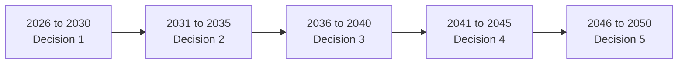

# Model Details
---

This section provides the reasoning and main assumptions in the model behind the GMPA.
STEVFNs represents the system as an interconnected network of nodes and edges.
Locations, technologies (assets) and moments in time are the nodes, and the flows of e.g. energy,
capacity, and emissions are the edges that link them.
Some of these are optimised by the model.

Every node in the network must balance, depending on its nature, either through an inequality (allows curtailment)
or an equality (inputs and outputs must match exactly).
This general method of accounting applies to all technologies, which keeps the model consistent and auditable.

The model then searches across the feasible combinations of investments and operation to find the one with the least cost
among them that meets different demands (e.g. electricity, transport, industry) within emissions limits.
This is a mathematical optimisation solved via a standard solver so the same inputs lead to the same answer.

## Geography

Each location (country in GMPA) is represented by a single node and its own input data, including resource profiles,
costs, and existing infrastructure. Within a country, the model assumes perfect interconnection within a country.
This "copper-plate" abstraction allows the modelling of trade between different locations without exponentially increasing
computational complexity.

Countries can then trade with each other via:
- power cables (in general assumed as subsea HVDC cables)
- ammonia and hydrogen shipping

The cost and energy losses of each link grow with the distance between two reference locations being connected.
While real distances would be longer, the model currently assumes straight line paths "as-the-bird-flies" between 
two sets of coordinates for simplicity.

## The timeline

The time-dependent version of STEVFNs plans over a multi-decade horizon, divided into discrete investment
periods. At the start of each period, it can decide to build new capacity of the available technologies. 
In the default setup, the planning horizon is 25 years, divided in 5-year reinvestment periods.

Two kinds of decisions are made simultaneously:

| Decision       | How often                                           | Example                          |
| -------------- | --------------------------------------------------- | -------------------------------- |
| **Investment** | At the start of each 5-year period                  | Build 10 GW of solar in 2030     |
| **Operation**  | Every hour of the typical days sampled in each year | How much a gas plant runs at 8pm |

Some inputs are given as annual values rather than hourly, such as industrial demands (e.g. cement or steel).
The model handles these on an annual basis.

### Representative days
 
Optimising every hour of every year over decades would be too large to solve quickly and computationally cheaply.
Instead, each year is represented by a sample of day(s) drawn from a full year of resource and demand data. Within
those days, electricity is modelled hour by hour.

The number of typical days per year can be changed. More days capture more of the variation across seasons, but make
the model larger. With only a few days per year, seasonal differences are only partly represented.

## How investment decisions work

The model tracks capacity as a stock. At each investment period it can add new capacity for any technology. That
capacity then follows a simple life cycle:

1. **Built.** It starts working in the period it is built. Links between countries start after a construction delay.
2. **In service.** It stays available until the end of its technical lifetime.
3. **Retired.** At the end of its lifetime it is removed automatically.

For example, a solar plant with a 25-year life built in 2030 is still working at the end of the model. A gas plant with a 15-year life built in 2030 retires in 2045.

**Existing infrastructure** is the starting stock, so that each country begins from its real energy system rather than a blank slate. It declines over time, either
at a constant assumed rate or following a country-specific retirement profile, depending on the data available.

Two further points matter for interpreting results:

- **Each decision knows what is already built** and what is about to retire. The model plans a sequence of investments, not a single build-out.
- **Capacity cannot be retired early.** It leaves service only at the end of its life, although it can sit idle.

## How costs are calculated

The model minimises the net present value of the total system cost.

**Capital costs.** The upfront cost of new capacity is turned into a stream of equal annual payments over the technology's
lifetime, like a loan. Each payment is then converted to present value using the system discount rate. This puts investments
made early and late on the same footing.

**The terminal charge.** A plant built in 2045 with a 25-year life has only 5 years of payments inside the model horizon, and
the other 20 fall after it ends. If these were ignored, late investments would look much cheaper than early ones, only because
the model stops. The model therefore also charges the payments that fall after the horizon.

**Operating costs.** Costs that depend on use, such as fuel and maintenance, are counted as the technology runs.

**Existing infrastructure** is treated as already paid for. Only its operating costs count.

**No inflation.** The model applies no inflation. Cost changes over time, such as falling technology costs, come from the input data
if provided explicitly for some technologies.

### What the reported costs mean

!!! warning
    input final detail on interpretation of results when ready

## Emissions

Emissions are limited by the model, not just reported. Each location can have a CO₂e budget for each investment period, reflecting a climate target, a policy commitment
or a decarbonisation pathway. The model must meet demand within that budget.

Different budget pathways define the scenarios for each country or group of collaborating countries.

## Sectors

- **Power.** Solar and wind (limited by the resource potential at each location), fossil generators, batteries, and hydrogen storage with conversion back to electricity.
- **Industry.** Cement production, with demand given annually.
- **Transport.** Passenger and freight vehicle fleets, sized by the distance they can drive each year. Costs currently include **capital only**, and fuel costs for
- combustion vehicles are not included in this version. Electric vehicles use electricity from the same network as everything else.

## Assumptions and limitations

|Assumption|What it means|How to read results|
|---|---|---|
|**One grid per country (copper plate)**|Energy moves freely inside a country. Local grid limits and grid investment are not included|Results are national totals, not siting advice. Costs may be understated especially where the grid is weak|
|**Perfect foresight**|The model knows all future costs, demand and resources|A least-cost benchmark, not a forecast|
|**Representative days**|A sample of typical days stands for each year|Fewer days means less seasonal detail|
|**Central planner**|No markets, prices or individual actors|Shows the cheapest system, not what markets would deliver|
|**Simplified relationships**|Costs and performance are kept in a form that can be solved reliably|Some real-world effects are approximated|
|**Simplified trade**|Straight-line distances, and regular shipping schedules (see below)|Trade costs are approximate|
|**Fixed lifetimes**|Capacity retires only at end of life|No early closures or life extensions|
|**Transport costs**|Capital only for now|Combustion vehicles look cheaper than they are|
|**Input data**|Results are only as good as the inputs|All inputs are documented and open to review|

### Shipping and the typical day

The model does not follow individual ships or voyages that last several days. It assumes a regular shipping schedule, so that every typical day looks the same. Under
this assumption only two things matter for the daily picture: how much fuel is shipped per day, and what time of day it arrives. This supports the sampling method used to
reduce computational complexity.

Ships are therefore treated as average departures per day. A ship that leaves every 4 days counts as a quarter of a shipload each day. Whole days at sea do not change
the daily pattern, and only the hours left over change the arrival time. Fuel storage at the ports absorbs the batches. Irregular schedules and weather delays are not represented.

The size reported for a shipping link is the largest amount of fuel shipped at one time. When ships leave less often than once a day, this is a daily average, and the
cargo per departure is larger.

## Further detail

Model architecture and details on the code for the overarching model can be found at [Architecture](architecture.md) and
[Generalised Model](generalised-model.md).

For information on specific asset design, equations and parameter tables, see [Base Assets](base-assets.md).